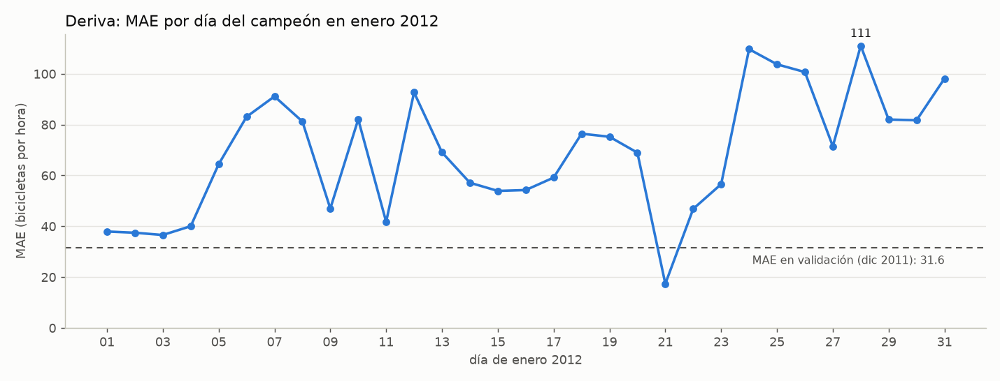

# Demanda de bicicletas

Pipeline diario que predice la demanda por hora (`cnt`) de Capital Bikeshare y guarda un plan de bicicletas por hora. Laboratorio 1 de Product Development, Maestría en Data Science, Universidad Galileo.

Este README se completa en la fase final. Por ahora documenta cómo obtener los datos y cómo levantar los servicios.

## Datos

`data/raw/hour.csv` está versionado con DVC contra un remoto local, que el evaluador no puede alcanzar. Para reproducir:

1. Descargar el UCI Bike Sharing Dataset: <https://archive.ics.uci.edu/dataset/275/bike+sharing+dataset>.
2. Extraer `hour.csv` en `data/raw/hour.csv`.
3. Comprobar que coincide con la versión registrada: `dvc status` responde que está al día (md5 en `data/raw/hour.csv.dvc`).

El archivo tiene 17,379 filas, del 2011-01-01 al 2012-12-31.

## Servicios (Airflow 3 y MLflow)

1. `make env` crea `.env` con `AIRFLOW_UID` (tu uid) y `MLFLOW_PORT`. En macOS el puerto 5000 suele ocuparlo AirPlay Receiver; en ese caso usa `MLFLOW_PORT=5001`.
2. `make up` (o `docker compose up -d`) construye las imágenes y levanta Postgres, Airflow (LocalExecutor) y MLflow.
   - Airflow: <http://localhost:8080>, usuario `airflow`, contraseña `airflow`.
   - MLflow: `http://localhost:$MLFLOW_PORT`. Dentro de compose Airflow lo ve como `http://mlflow:5000`.
3. El DAG `prediccion_diaria` nace pausado. Actívalo en la UI y dispáralo con la fecha lógica explícita (por ejemplo `2012-01-02`), o desde la terminal:

   ```
   docker compose exec airflow-scheduler airflow dags unpause prediccion_diaria
   docker compose exec airflow-scheduler airflow dags trigger prediccion_diaria --logical-date 2012-01-02T00:00:00+00:00
   ```

4. Backfill de enero de 2012 (31 ejecuciones, 741 filas en `salidas/predicciones.db`; tres días de ese mes tienen 23 horas en la fuente):

   ```
   docker compose exec airflow-scheduler airflow backfill create --dag-id prediccion_diaria \
     --from-date 2012-01-01 --to-date 2012-01-31 --max-active-runs 4 --reprocess-behavior completed
   ```

El repo se monta en `/opt/bicis/proyecto`, la fuente en `/opt/bicis/fuente` (solo lectura) y los logs en `airflow/logs/`. Las pruebas del DAG necesitan Airflow y corren dentro de la imagen con `make test-dag`; `make entrenar-docker` entrena con exactamente las mismas versiones que cargan el modelo en Airflow.

## Deriva: el campeón en producción

`scripts/evaluar_produccion.py` une `salidas/predicciones.db` con la demanda real de la fuente y compara enero de 2012 (producción, tras el backfill) con diciembre de 2011 (validación, recalculada con el mismo campeón y el mismo factor). Campeón: `demanda-bicis` versión 1 (`hgb-lr-0.05`), factor 0.05; costos 3 por bicicleta faltante y 1 por sobrante.

| métrica | diciembre 2011 (validación) | enero 2012 (producción) | cambio |
|---|---|---|---|
| filas (horas) | 741 | 741 | +0 |
| demanda media por hora | 117.8 | 130.6 | +12.71 (+11%) |
| MAE | 31.64 | 68.71 | +37.08 (+117%) |
| sesgo (predicción − real) | +15.20 | -67.76 | -82.96 |
| costo por hora | 46.43 | 194.89 | +148.46 (+320%) |

El sesgo pasa de +15 a −68 bicicletas por hora: el modelo subestima casi toda la demanda de enero de 2012, y ese sesgo explica casi todo el MAE. Con los costos del laboratorio, faltar cuesta tres veces más que sobrar, así que el costo por hora se cuadruplica. La causa es la deriva: el modelo no ve el año y aprendió, con un solo año de datos, que `mnth = 1` significa poca demanda (enero de 2011 promedió 56 bicicletas por hora, el sistema estaba arrancando), pero enero de 2012 promedia 131. La predicción media de enero de 2012 fue 63. Esto es lo que justifica reentrenar con datos recientes.



El único día por debajo de la referencia de validación es el 21 de enero (nevada en Washington): la demanda real cayó al nivel que el modelo esperaba. Para regenerar la tabla y la figura, con MLflow arriba:

```
make evaluar
```

## Compuerta de promoción

`bicis.compuerta.compuerta(challenger, champion, umbrales)` es una función pura (no importa MLflow) que decide si un modelo nuevo reemplaza al campeón. Aplica cuatro reglas en orden y devuelve `(promover, motivo)`, donde el motivo nombra la primera regla que falla con sus números:

1. Features idénticas (misma lista, mismo orden).
2. `latencia_p95_ms` ≤ 200.
3. `tamano_modelo_mb` ≤ 100.
4. `costo_hora_eval` al menos 2 % más bajo que el del campeón.

Los umbrales viven en `params.yaml` bajo `compuerta`. Con estas reglas, el random forest de la escalera (203 MB) nunca se promovería aunque mejorara el costo, y un retador con otras features se rechaza antes de mirar métricas.
